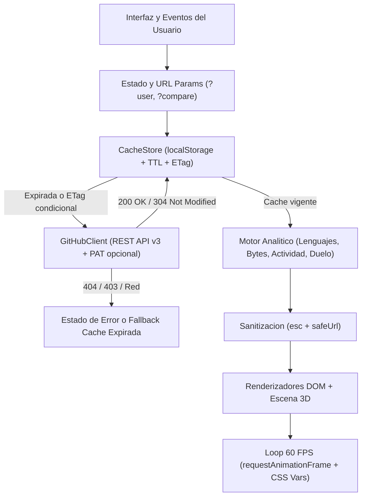
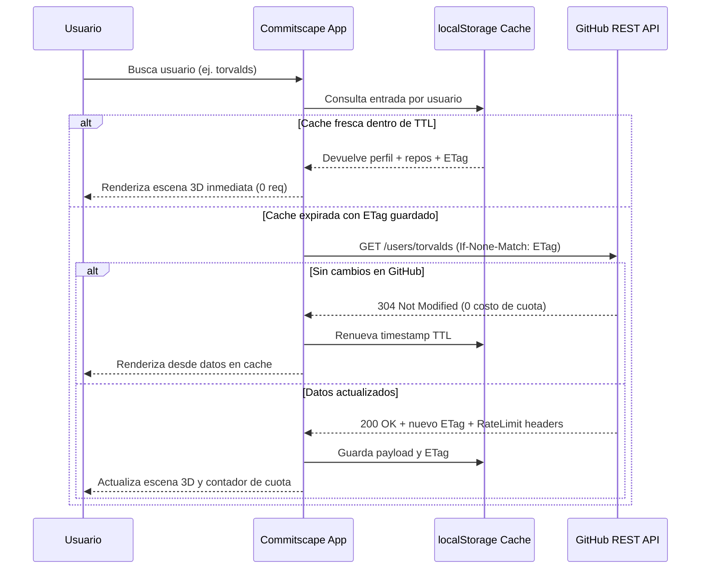

# Arquitectura Técnica y Estructura del Proyecto

Este documento describe la arquitectura implementada en **Commitscape (Repoescena)** para escalar manteniendo intacta su premisa **zero-build**: ejecución directa en cualquier navegador sin compiladores, empaquetadores ni servidores intermedios.

---

## 1. Filosofía Zero-Build y Portabilidad

### Punto de partida y evolución
El proyecto nació en un único archivo `index.html` autónomo (escenario `.scene`/`.bar3`, tarjetas `.tilt`, sanitización `esc()`). Al evolucionar hacia el ecosistema completo de **7 objetos 3D** y funcionalidades avanzadas, se mantuvo la portabilidad absoluta sin herramientas de build ni dependencias externas.

### Evolución modular implementada (compatibilidad `file://` y `http://`)
El proyecto evolucionó desde un único archivo hacia una arquitectura modular en `styles/` y `src/` manteniendo cero pasos de compilación (*zero-build*). Para garantizar compatibilidad total tanto al abrir `index.html` directamente desde disco (`file://`, donde los navegadores bloquean `type="module"` por CORS) como al servirlo por HTTP (GitHub Pages, Netlify o Vercel), los módulos se estructuran como IIFE ordenados con `<script defer>` bajo el espacio de nombres `window.Commitscape`.

#### Estructura actual del proyecto
```text
Commitscape/
├── index.html                 # Punto de entrada semantico, temas, modales y carga ordenada defer
├── manifest.json              # Manifiesto PWA instalable
├── sw.js                      # Service Worker offline-first para shell estatico
├── assets/
│   └── icon.svg               # Icono vectorial de la aplicacion
├── styles/
│   ├── tokens.css             # Paletas (Oscuro, Esmeralda, Synthwave, Claro) y reduced-motion
│   ├── scene3d.css            # Cubo logo, Skyline, Sistema Orbital, Terrain 70d/365d, Flip 180 y Duelo
│   └── components.css         # Topbar, selector de temas, cuota API, buscador dual, filtros y modales
├── src/
│   ├── main.js                # Inicializacion, temas, registro SW, flujo Perfil/Duelo/Orgs y modal API
│   ├── state.js               # Store centralizado y sincronizacion deep linking (?user, ?compare)
│   ├── api/
│   │   ├── githubClient.js    # REST v3 + ETag (304), paginacion, org members y GraphQL 365d con PAT
│   │   └── cacheStore.js      # Persistencia en localStorage (cache TTL, poda LRU, historial, PAT, tema)
│   ├── domain/
│   │   ├── analytics.js       # Calculos por repo/bytes, matriz 70d/365d, duelo y trofeos
│   │   └── linguistColors.js  # Diccionario oficial de colores GitHub Linguist con fallback
│   ├── ui/
│   │   ├── stage3d.js         # Orbit drag en escenarios espaciales (tarjetas fijas sin inclinacion hover)
│   │   ├── exportCard.js      # Exportador PNG/SVG perfil, copiado al portapapeles y PNG de duelo
│   │   ├── neuralNet.js       # Red neuronal interactiva en Canvas 3D con sinapsis y pulsos
│   │   ├── renderHome.js      # Portada de inicio con red neuronal tecnologica y repos populares
│   │   ├── renderProfile.js   # Holocarta, Org members, Trofeos, Skyline/Orbital y Paisaje 70d/365d
│   │   ├── renderRepos.js     # Explorador filtrable, tarjetas firmes con gema cubica e Inspector Flip 180
│   │   └── renderCompare.js   # Arena de Duelo con comparativa isometrica y exportacion PNG
│   └── utils/
│       └── sanitize.js        # esc(), safeUrl() (solo http/https) y formateadores es-AR
├── tests/
│   └── commitscape.test.mjs   # Suite de pruebas unitarias (node:test) sin dependencias externas
└── docs/                      # Documentacion tecnica y visual del proyecto
```

---

## 2. Diagrama de Flujo y Arquitectura de Capas



### Secuencia de consulta con caché y `ETag`



---

## 3. Gestión de Estado y Bucle Visual 3D

### Estado centralizado ligero (`state.js`)
En lugar de manipular el DOM de forma dispersa cuando crecen los filtros y modos de vista, un objeto de estado único coordina las transiciones sin frameworks externos:

- `mode`: `"single"` | `"compare"` (vista individual o Arena de Duelo).
- `languageMetric`: `"repos"` | `"bytes"` (escala del Skyline 3D).
- `activeLanguage`: `string | null` (lenguaje seleccionado al hacer clic en una torre 3D para filtrar la grilla).
- `filters`: `{ query, includeForks, includeArchived, sortBy }`.
- `rateLimit`: `{ limit, remaining, resetAt }` actualizado automáticamente con las cabeceras de cada respuesta HTTP.
- `profiles`: caché en memoria de los perfiles analizados en la sesión.

### Física 3D desacoplada (`requestAnimationFrame`)
En `index.html` v1, el evento `onmousemove` escribe directamente `e.style.transform`. Para escalar a tarjetas multicapa con brillo especular y escenario orbital a 60 FPS estables:
- Los listeners de puntero (`pointermove`, `pointerleave`) solo registran coordenadas objetivo normalizadas `(targetX, targetY)` en un mapa ligero (`WeakMap` por elemento).
- Un único bucle `requestAnimationFrame` activo únicamente mientras existen tarjetas en movimiento aplica interpolación lineal (*lerp*) hacia los valores objetivo y actualiza variables CSS (`--rx`, `--ry`, `--glare-x`, `--glare-y`).
- Al alcanzar el reposo o cuando `@media (prefers-reduced-motion: reduce)` está activo, el bucle se detiene automáticamente sin consumir CPU en segundo plano.

---

## 4. Seguridad, Privacidad y Resiliencia

El prototipo v1 establece una regla fundamental en el README original: *"Todo texto que viene de una API se escapa con `esc()` antes de insertarlo en el HTML"*. La arquitectura evolucionada refuerza esta postura en cuatro frentes:

1. **Escape HTML obligatorio (`esc()`)**: Toda cadena proveniente de GitHub (`login`, `name`, `bio`, `description`, `language`, `topics`, `license`) pasa por escape de `&`, `<`, `>`, `"` y `'` antes de entrar al DOM, o se inserta mediante `textContent`.
2. **Validación estricta de esquemas en URLs (`safeUrl()`)**: En campos navegables como `avatar_url`, `html_url` y especialmente `homepage` (editable libremente por cualquier usuario de GitHub), se exige que la URL comience por `https://` o `http://`, bloqueando cualquier vector `javascript:` o `data:`.
3. **Aislamiento en enlaces externos**: Todo enlace externo mantiene `target="_blank" rel="noopener noreferrer"`.
4. **Manejo responsable del Token opcional (PAT)**:
   - Si el usuario decide introducir un token personal para ampliar la cuota a 5.000 req/h, se recomienda almacenarlo en `sessionStorage` por defecto (o `localStorage` solo con consentimiento explícito del usuario) y ofrecer un botón visible para revocarlo/borrarlo al instante.
   - El token se envía únicamente en la cabecera `Authorization: Bearer ...` hacia `https://api.github.com`.
5. **Content Security Policy (CSP) compatible**: Al evitar scripts inline innecesarios tras la modularización y no depender de `eval()`, el proyecto puede servirse con una CSP estricta (`default-src 'self'; connect-src https://api.github.com; img-src 'self' https://avatars.githubusercontent.com data:`).
