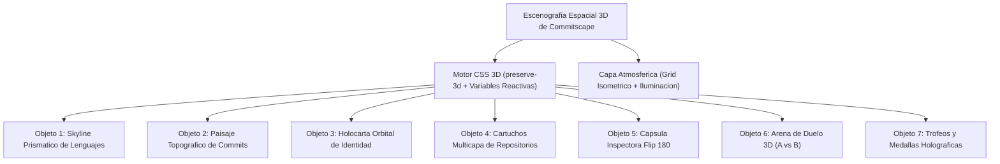
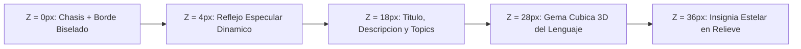

# Diseño 3D de Objetos y Sistema Visual

Este documento define la estética, la geometría espacial y las especificaciones de diseño de los **objetos tridimensionales** de **Commitscape (Repoescena)**. Su propósito es que cada métrica de un desarrollador en GitHub —lenguajes, repositorios, actividad de commits, impacto comunitario y comparativas— se materialice como un **objeto 3D físico con volumen, luz, sombra e inercia**, logrando una experiencia visualmente llamativa sin comprometer la legibilidad ni los 60 FPS.

---

## 1. Arquitectura Espacial 3D

El proyecto evoluciona la escena inicial de `index.html` (`.scene` con `perspective: 900px`, `.stage` rotando con `transform-style: preserve-3d` y tarjetas `.tilt`) hacia un **escenario espacial multicapa en CSS 3D puro** —opcionalmente enriquecido por un lienzo Canvas/WebGL ligero de partículas atmosféricas— que conserva la filosofía *zero-build*.

### Principios de física e iluminación compartidos
- **Fuente de luz direccional virtual** ubicada en el cuadrante superior izquierdo (`-35deg` en X, `+45deg` en Y): las caras superiores reciben brillo claro, los frentes mantienen el color puro del lenguaje y las caras laterales quedan en penumbra cálida/fría.
- **Variables CSS dinámicas actualizadas por `requestAnimationFrame`**: `--rx`, `--ry` (ángulos de inclinación amortiguados con *lerp*), `--glare-x`, `--glare-y` (posición del reflejo especular) y `--shadow-x`, `--shadow-y` (desfase inverso de sombra).
- **Profundidad coherente en eje `Z`**: Ningún elemento interactivo comparte exactamente el mismo plano cuando pertenece a jerarquías distintas; los relieves van desde `0px` (chasis base) hasta `48px` (etiquetas y gemas flotantes).

---

## 2. Catálogo Detallado de los 7 Objetos 3D

### Objeto 1 — Skyline Prismático de Lenguajes 3D (Torres Volumétricas)

Evoluciona el objeto central del prototipo (`.bar3` con pseudo-elementos `::before` y `::after` en `.stage`). En la versión actual, cada prisma tiene cara frontal, lateral derecha y tapa superior con oscilación automática entre `rotateY(-25deg)` y `rotateY(25deg)`. La versión evolucionada lo convierte en un **prisma completo sobre plataforma isométrica interactiva**:

- **Geometría completa del prisma**:
  - **Cara frontal (`translateZ(22px)`)**: Color base del lenguaje con gradiente vertical sutil que refuerza la sensación de altura.
  - **Caras laterales izquierda y derecha (`rotateY(±90deg) translateZ(22px)`)**: Oscurecidas entre un `35%` y `50%` mediante superposición lineal para evitar huecos visuales si el usuario orbita manualmente el escenario hasta `±65°`.
  - **Cara trasera (`rotateY(180deg) translateZ(22px)`)**: Mantiene solidez volumétrica en rotaciones amplias.
  - **Tapa superior especular (`rotateX(90deg) translateZ(22px)`)**: Acabado vítreo iluminado con borde interior luminoso (`inset 0 0 0 1px rgba(255,255,255,0.35)`).
  - **Base de anclaje y sombra**: Plataforma con retícula cartesiana tenue (`1px solid rgba(56,189,248,0.14)`) en `rotateX(90deg)` que proyecta un halo de color debajo de cada torre.
- **Etiqueta holográfica flotante**: El contador numérico (`repos` o `% de bytes`) levita a `translateZ(28px)` sobre la tapa, y el nombre del lenguaje descansa inclinado sobre el frente del zócalo.
- **Interacción**:
  - **Arrastre orbital (*drag to orbit*)**: Al arrastrar con el mouse o dedo sobre `.scene`, el usuario controla `rotateX` (`-35°` a `-8°`) y `rotateY` (`-60°` a `+60°`), pausando la auto-rotación suave.
  - **Selección en escena**: Hacer clic sobre una torre 3D eleva la columna seleccionada (`translateY(-8px)`), atenúa las demás y filtra automáticamente la grilla inferior por ese lenguaje.
  - **Conmutador de escala**: Alterna en vivo la altura de las torres entre **Por Repositorios** (conteo directo) y **Por Bytes Reales** (proporción porcentual del código).

---

### Objeto 2 — Paisaje Topográfico de Actividad 3D (*Commitscape Voxel Terrain*)

Da sentido literal al nombre del proyecto (**Commitscape**: paisaje de commits). Representa la actividad pública reciente del desarrollador como un **relieve arquitectónico tridimensional de columnas/vóxeles**:

- **Composición espacial**: Matriz isométrica inclinada (`rotateX(52deg) rotateZ(-36deg)`) de celdas cuadradas correspondientes a los días/semanas de actividad reciente extraída de `/users/{user}/events/public` (eventos de `PushEvent`, `PullRequestEvent`, `CreateEvent`).
- **Volumetría por intensidad**:
  - Días sin actividad: losas planas rasantes de `2px` de espesor en azul abisal (`#0f2233`).
  - Días activos: vóxeles extruidos cuya altura (`6px` a `54px`) y emisión luminosa crecen proporcionalmente al volumen de commits o eventos del día.
- **Interacción**: Pasar el cursor sobre cualquier columna del terreno muestra un *tooltip* flotante elevado en Z con la fecha y el detalle de eventos (`ej. 7 commits en 2 repositorios`), iluminando la columna con un pulso cian.

---

### Objeto 3 — Holocarta de Identidad y Avatar Orbital 3D

Transforma el encabezado actual (`.top` + `.st`) en una **pieza escultórica de presentación personal**:

- **Cápsula orbital del avatar**:
  - El avatar del usuario (`96x96px` o `112x112px`) ocupa el plano central (`translateZ(24px)`) dentro de un marco circular biselado con resplandor cian (`#38bdf8`).
  - Dos **anillos orbitales 3D inclinados** (`rotateX(68deg) rotateY(±22deg)`) giran lentamente en sentidos opuestos alrededor del retrato, portando micro-satélites luminosos.
- **Medallones volumétricos de estadísticas**:
  - Las métricas globales (`Repositorios`, `Seguidores`, `★ Estrellas totales`, `⑂ Forks totales`, `Año de alta`) se presentan como bloques biselados independientes en `translateZ(14px)` con borde superior iluminado y micro-elevación al hacer hover.
- **Anatomía en 5 planos Z** de la Holocarta:
  1. `Z = 0px`: Chasis translúcido oscuro (`#12283a`) con patrón sutil de placa de circuito.
  2. `Z = 4px`: Capa especular móvil (`glare`) reactiva al cursor.
  3. `Z = 14px`: Medallones de métricas y bio del perfil.
  4. `Z = 24px`: Avatar central con sombra proyectada hacia el chasis.
  5. `Z = 34px`: Anillos orbitales frontales e insignia de año/rol.

---

### Objeto 4 — Cartuchos Volumétricos de Repositorios 3D (Grilla Multicapa)

Evoluciona las tarjetas `.r` con efecto `.tilt` (`±14°` en `rotateX/Y`) hacia **cartuchos 3D estratificados de 5 capas en el eje `Z`** dentro de una grilla con `perspective: 950px`:

| Capa | Profundidad (`translateZ`) | Comportamiento Visual y Físico |
| :--- | :--- | :--- |
| **1. Chasis Base** | `0px` | Tarjeta `#12283a` con borde `#1e4560`, esquina biselada y sombra difusa dinámica desplazada en sentido opuesto al cursor. |
| **2. Brillo Especular** | `4px` | `radial-gradient` centrado en `--glare-x` / `--glare-y` que simula cristal o policarbonato pulido bajo luz de estudio. |
| **3. Contenido y Topics** | `18px` | Nombre del repositorio, descripción acotada a 2-3 líneas, píldoras de `topics` (máx. 3) y marca de licencia o `fork` si aplica. |
| **4. Gema 3D del Lenguaje** | `28px` | Pequeño **cubo/octaedro CSS 3D giratorio** en la esquina inferior teñido con el color oficial de GitHub Linguist del lenguaje principal del repo. |
| **5. Insignia Estelar** | `36px` | Medalla flotante `★ estrellas` y `⑂ forks` con relieve superior e iluminación dorada (`#facc15`) cuando el repositorio supera hitos de popularidad. |

- **Física amortiguada**: Sustituye la actualización instantánea directa de `onmousemove` por interpolación suave con `requestAnimationFrame`, evitando saltos bruscos al entrar o salir del cartucho.

---

### Objeto 5 — Cápsula Inspectora de Repositorio 3D (`Flip 180°`)

Al seleccionar un cartucho (botón *Inspeccionar* o clic principal reservando un enlace directo externo), se abre un `<dialog>` tridimensional concebido como una **cápsula giratoria de doble cara**:

- **Cara A (Arquitectura y Métricas)**:
  - Barra segmentada volumétrica en 3D con el **desglose real en bytes** de los lenguajes propios de ese repositorio (`/repos/{owner}/{repo}/languages`).
  - Tamaño en disco (`KB`/`MB`), rama por defecto, licencia SPDX, fecha de último *push* y botón directo hacia GitHub o la demo en vivo (`homepage` validada como `https://`).
- **Cara B (Actividad e Integración — `rotateY(180deg)`)**:
  - Botón *Girar cápsula* que rota el objeto completo `180°` en el eje `Y` con transición cúbica suave (`0.65s cubic-bezier(0.22, 1, 0.36, 1)`).
  - Muestra línea temporal sintética de actividad reciente del repositorio, comando de clonado listo para copiar (`git clone ...`) y vista previa de métricas comunitarias (*issues* abiertos, *watchers*, *forks*).

---

### Objeto 6 — Arena de Duelo 3D (Comparador Espacial de Dos Usuarios)

Cuando se activa la comparación `@usuarioA` vs `@usuarioB` (una de las próximas mejoras declaradas en el README original), el escenario se transforma en una **Arena Simétrica 3D**:

- **Torres enfrentadas**: Dos hileras prismáticas inclinadas frente a frente (`Usuario A` en acento cian `#38bdf8` vs `Usuario B` en acento magenta `#f472b6`) comparando métricas normalizadas:
  - Repositorios propios totales.
  - Estrellas acumuladas (`★`).
  - Forks totales (`⑂`).
  - Seguidores y años de antigüedad.
- **Núcleo Central de Afinidad 3D**: Esfera o prisma hexagonal flotante entre ambos contendientes que muestra el **porcentaje de coincidencia tecnológica** (lenguajes compartidos entre ambos portafolios).

---

### Objeto 7 — Medallas y Trofeos Holográficos 3D

Insignias poligonales extruidas que se desbloquean automáticamente en función de los datos reales recuperados de la API, sin gamificación artificial:

- **Arquitecto Estelar**: Superar determinado umbral de estrellas acumuladas en repositorios propios.
- **Políglota del Código**: Dominar 5 o más lenguajes distintos con repositorios propios activos.
- **Veterano Open Source**: Perfil con más de 8 años de antigüedad en GitHub.
- **Constructor Constante**: Alta densidad de repositorios originales no bifurcados (`own.length`).

Cada trofeo se construye con un disco metálico biselado, símbolo central elevado a `translateZ(16px)` y destello diagonal (*sheen*) al interactuar con él.

---

## 3. Paleta de Colores, Materiales y GitHub Linguist

Commitscape respeta la identidad nocturna de terminal de `index.html` (`#0b1620`, `'Courier New', monospace`) y la expande con tokens semánticos consistentes:

| Token / Superficie | Color Hex | Uso en la Escena 3D |
| :--- | :--- | :--- |
| **Fondo Espacial Base** | `#0b1620` | Lienzo profundo de alto contraste con gradiente radial sutil `#102334` en el centro del escenario. |
| **Chasis de Cartuchos** | `#12283a` | Cuerpo base de tarjetas, holocarta y paneles (`border: 1px solid #1e4560`). |
| **Texto Principal / Secundario** | `#e5f3ff` / `#9cc3dd` | Tipografía legible sobre fondos oscuros (contraste superior a 7:1 en texto principal). |
| **Acentos de Escena (Paleta `COL`)** | `#38bdf8`, `#f472b6`, `#facc15`, `#4ade80`, `#c084fc`, `#fb923c` | Fallback rotativo de torres y acentos de interfaz (conservando los 6 colores del prototipo). |
| **Mapeo Oficial GitHub Linguist** | Dinámico por lenguaje | JavaScript (`#f1e05a`), TypeScript (`#3178c6`), Python (`#3572A5`), Rust (`#dea584`), Go (`#00ADD8`), HTML (`#e34c26`), CSS (`#563d7c`), C++ (`#f34b7d`), Java (`#b07219`), C (`#555555`). |
| **Estado de Error / Cuota** | `#5a1d1d` / `#ffd6d6` | Alertas claras cuando ocurre `404` o `403` (conservado del prototipo). |

---

## 4. Rendimiento a 60 FPS y Accesibilidad Visual

- **Propiedades compositor-friendly**: Todas las animaciones 3D operan exclusivamente sobre `transform` y `opacity`, evitando recálculos de *layout* (`width`, `height`, `top`, `left`) durante la interacción del puntero.
- **Gestión inteligente de `will-change`**: Solo se activa dinámicamente mientras el usuario interactúa con un cartucho o mueve la escena orbital, liberando memoria de capas GPU cuando los elementos quedan en reposo.
- **Soporte estricto de `prefers-reduced-motion`**:
  - Cuando el sistema del usuario solicita movimiento reducido, se detiene la rotación continua de `.stage`, la órbita del avatar y los destellos automáticos.
  - Los prismas 3D se muestran inmediatamente en una **pose isométrica fija y legible** (`rotateX(-16deg) rotateY(-20deg)`), conservando la claridad del diseño tridimensional sin mareo cinético.
- **Lectores de pantalla y contraste**: Cada objeto 3D decorativo o geométrico (`::before`, `::after`, anillos orbitales) se oculta de la lectura redundante (`aria-hidden="true"`), mientras las cifras y etiquetas se exponen en texto accesible con foco visible de teclado (`:focus-visible`).
