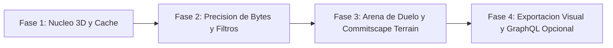

# Guía de Uso, Despliegue y Hoja de Ruta

Esta guía explica cómo ejecutar **Commitscape (Repoescena)** en local, desplegarlo en servicios de hosting estático sin configuración compleja, utilizar los controles de interacción 3D con accesibilidad y seguir la hoja de ruta de evolución del proyecto.

---

## 1. Ejecución Local Inmediata

El proyecto actual no requiere instalación de paquetes (`npm install`), compilación ni variables de entorno.

### Opción A · Apertura directa (Prototipo v1 single-file)
1. Ubicá el archivo [index.html](../index.html) en la carpeta del proyecto.
2. Abrilo directamente con doble clic en cualquier navegador moderno (Chrome, Firefox, Edge o Safari).

### Opción B · Servidor estático local (Recomendado para ES Modules futuros)
Desde la carpeta raíz del proyecto, elegí cualquiera de estos comandos según las herramientas que tengas instaladas:

```bash
# Con Node.js
npx serve .

# Con Python 3
python -m http.server 8080
```

Luego ingresá a `http://localhost:3000` (o `http://localhost:8080`). También podés usar la extensión **Live Server** en VS Code.

---

## 2. Despliegue en Producción (Zero-Config)

Gracias a su arquitectura estática 100% cliente, Commitscape puede publicarse de forma gratuita en segundos:

- **GitHub Pages**:
  1. Subí el repositorio a GitHub.
  2. Ingresá a `Settings -> Pages -> Build and deployment`.
  3. Seleccioná la rama `main` y la carpeta raíz `/ (root)`.
  4. Guardá los cambios; el sitio quedará activo bajo `https://<tu-usuario>.github.io/<repositorio>/`.
- **Netlify**: Arrastrá la carpeta raíz del proyecto a Netlify Drop o conectá el repositorio con *Build command* vacío y *Publish directory* `.`.
- **Vercel**: Importá el repositorio eligiendo el preset `Other` (sin comando de build y directorio de salida raíz).

---

## 3. Guía de Interacción 3D, Teclado y Accesibilidad

### Controles en Escena 3D
- **Búsqueda de perfil**: Escribí un usuario de GitHub (por ejemplo `torvalds`, `gaearon` o tu propio usuario) y presioná `Enter` o clic en **Ver perfil**.
- **Inspección de Cartuchos (`.tilt`)**: Desplazá el puntero sobre cualquier tarjeta de repositorio para inclinar sus planos en el eje `Z` y activar el reflejo especular.
- **Órbita del Skyline 3D (Evolución)**: Arrastrá sobre el escenario de torres prismáticas para rotarlo libremente; hacé clic sobre una torre de lenguaje para filtrar los repositorios inferiores.
- **Cápsula Inspectora Flip 180° (Evolución)**: Activá un cartucho para abrir su inspector tridimensional y alterná entre la cara técnica y la cara de actividad.

### Navegación por teclado y accesibilidad
- **`Tab` / `Shift + Tab`**: Recorré el buscador, chips de perfiles sugeridos, botones de filtro, torres del Skyline 3D y cartuchos de repositorios con indicador de foco visible.
- **`Enter` / `Espacio`**: Ejecuta búsqueda, selecciona un lenguaje en la escena 3D o abre la Cápsula Inspectora.
- **`Escape`**: Cierra el `<dialog>` de inspección o limpia el filtro activo.
- **Movimiento reducido (`prefers-reduced-motion: reduce`)**: Si tenés desactivadas las animaciones en tu sistema operativo o navegador, Commitscape detiene las rotaciones continuas, transiciones de inclinación y animaciones de crecimiento (`grow`), mostrando los prismas 3D en una perspectiva estática cómoda y sin mareo visual.

---

## 4. Hoja de Ruta de Evolución (Roadmap)



### Fase 1 · Resiliencia y Escena 3D Base (Implementada)
- [x] Incorporar capa de caché en `localStorage` con TTL de 15 minutos y validación condicional `ETag` (`304`).
- [x] Mostrar píldora en vivo con cuota restante de GitHub (`X-RateLimit-Remaining`).
- [x] Evolucionar `.bar3` hacia prismas completos de 4 caras + tapa + plataforma reticular con arrastre orbital.
- [x] Incorporar Holocarta de identidad con anillos orbitales 3D y Cartuchos de 5 capas `Z` con interpolación `requestAnimationFrame`.
- [x] Añadir chips de acceso rápido a perfiles destacados y *deep linking* (`?user=...`).

### Fase 2 · Precisión Analítica y Explorador Completo (Implementada)
- [x] Implementar conmutador **Por Repos vs. Por Bytes reales** consultando `/repos/{owner}/{repo}/languages` con concurrencia acotada.
- [x] Aplicar paleta oficial de colores de **GitHub Linguist**.
- [x] Añadir paginación automática para perfiles con más de 100 repositorios.
- [x] Integrar buscador local en grilla, ordenamiento múltiple, filtro por torre 3D seleccionada y soporte de PAT opcional.

### Fase 3 · Identidad Commitscape y Comparador Social (Implementada)
- [x] Construir el **Paisaje Topográfico de Actividad 3D (*Commitscape Terrain*)** a partir de `/users/{user}/events/public`.
- [x] Implementar la **Cápsula Inspectora de Repositorio 3D (Flip 180°)**.
- [x] Desarrollar la **Arena de Duelo 3D** para comparar dos usuarios (`?user=A&compare=B`) con índice de afinidad tecnológica.
- [x] Generar automáticamente **Trofeos Holográficos 3D** basados en hitos reales del perfil.

### Fase 4 · Extensiones de Portfolio (Implementada)
- [x] Exportador de tarjeta resumen del perfil como imagen PNG, SVG vectorial, copiado al portapapeles y PNG de Arena de Duelo (`exportCard.js`).
- [x] Modo opcional autenticado con **GitHub GraphQL API** para obtener la matriz anual exacta de contribuciones (`contributionCalendar` de 365 días) en el paisaje de actividad.
- [x] Vista alternativa **Sistema Orbital de Lenguajes**, soporte para **Organizaciones**, selector de 4 **Temas visuales**, soporte **PWA offline** (`manifest.json` + `sw.js`) y pruebas unitarias (`tests/commitscape.test.mjs`).
