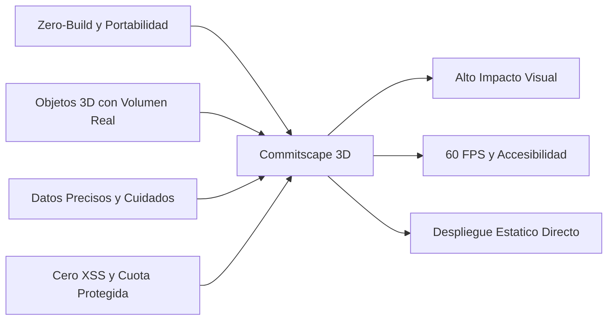

# Documentación de Commitscape (Repoescena) · Índice y Revisión de la Idea

Bienvenido a la documentación completa de **Commitscape (Repoescena) · Paisaje y Escenario 3D de Perfiles de GitHub**. Este conjunto de documentos recoge la revisión integral de la idea original, la propuesta de mejoras funcionales y técnicas, y la especificación detallada de todos los **diseños de objetos en 3D** que convierten al proyecto en una pieza visualmente impactante para portfolio.

---

## 1. Revisión y Auditoría de la Idea Original

### Punto de partida (Prototipo v1 · `index.html`)
El prototipo inicial demostró una base limpia, funcional y autónoma en un único archivo HTML sin proceso de *build*, librerías externas ni base de datos:

- **Consulta paralela a GitHub REST API**: Obtención simultánea del perfil (`/users/{user}`) y sus repositorios recientes (`/users/{user}/repos?per_page=100&sort=updated`) mediante `Promise.all`.
- **Primer escenario de prismas 3D**: Gráfico de barras en perspectiva (`perspective: 900px`, `transform-style: preserve-3d`) con escenario rotatorio (`.stage`) y prismas construidos con pseudo-elementos `::before` (cara lateral en penumbra) y `::after` (tapa superior iluminada), además de animación escalonada de crecimiento (`grow`).
- **Tarjetas reactivas `.tilt`**: Inclinación 3D en tiempo real sobre el top 6 de repositorios por estrellas según la posición del puntero.
- **Buenas prácticas de ingeniería desde el origen**:
  - Sanitización sistemática anti-XSS mediante `esc()` antes de interpolar contenido externo de la API en el DOM.
  - Manejo explícito de estados de carga y errores de usuario inexistente (`404`) y límite de tasa excedido (`403`).
  - Soporte nativo de accesibilidad mediante `@media (prefers-reduced-motion: reduce)`.

### Diagnóstico de oportunidades de mejora
Al evaluar la idea frente a las limitaciones declaradas y los objetivos de alto impacto visual para un portfolio, se identificaron cinco ejes estratégicos de evolución:

1. **De un único gráfico prismático a un ecosistema de 7 objetos 3D cohesivos**: Los prismas actuales carecen de cara trasera/izquierda completa si se amplía el ángulo de giro, y el resto de la interfaz (avatar, métricas, repositorios y comparativas) es aún plana o de inclinación simple. Evolucionar hacia una escenografía de **7 objetos 3D** (Skyline Prismático completo, Paisaje Topográfico *Commitscape*, Holocarta Orbital, Cartuchos Multicapa, Cápsula Inspectora Flip 180°, Arena de Duelo y Trofeos Holográficos) da coherencia espacial a todo el producto.
2. **Desglose real en bytes vs. lenguaje principal único**: Agrupar por `repo.language` subestima lenguajes secundarios críticos (por ejemplo, proyectos donde CSS, SQL o Shell conviven con TypeScript o Python). Incorporar un **motor dual** que consulte `/repos/{owner}/{repo}/languages` bajo demanda o sobre los repositorios principales resuelve esa distorsión sin desperdiciar cuota.
3. **Superación del límite de 100 repositorios**: Perfiles activos u organizaciones superan fácilmente los 100 repositorios públicos. Implementar paginación automática progresiva (siguiendo el enlace `Link` / parámetro `page`) y herramientas de búsqueda/ordenamiento interno vuelve completo el análisis.
4. **Resiliencia ante el límite de 60 consultas/hora**: Sin autenticación, la API pública de GitHub limita por IP. Combinar **caché persistente en `localStorage` con TTL**, **validación condicional mediante `ETag` (`If-None-Match` -> HTTP `304` que no consume cuota)** y un **Personal Access Token (PAT) opcional** multiplica la disponibilidad del servicio.
5. **Comparador espacial y lectura de actividad**: Sumar el modo de comparación entre dos perfiles (**Arena de Duelo 3D**) y un paisaje topográfico de actividad pública reciente transforma un visor estático en una herramienta analítica memorable.

---

## 2. Comparativa: Prototipo Original vs. Commitscape Evolucionado

| Dimensión | Prototipo Original (v1) | Commitscape / Repoescena (Propuesta Completa) |
| :--- | :--- | :--- |
| **Objetos y Escena 3D** | Prismas de 3 caras visibles (`.bar3`) + inclinación simple (`.tilt`) | **Ecosistema de 7 objetos 3D**: Skyline prismático completo de 5 caras visibles, Terreno Voxel de Commits, Holocarta Orbital, Cartuchos de 5 capas Z, Inspector Flip 180°, Arena de Duelo y Medallas 3D |
| **Análisis de lenguajes** | Conteo simple por campo `language` de cada repo propio | **Motor Dual**: modo instantáneo por repo + **desglose real en bytes y porcentajes** (`/repos/{owner}/{repo}/languages`) con paleta oficial GitHub Linguist |
| **Cobertura de repositorios** | Tope fijo en los primeros 100 repositorios recientes | **Paginación completa** (>100 repos), filtros por lenguaje/forks/archivados y búsqueda instantánea en grilla |
| **Comparación de perfiles** | Consulta individual de un único usuario | **Arena de Duelo 3D** para contrastar `@usuarioA` vs `@usuarioB` con prismas enfrentados e índice de afinidad |
| **Cuota de API y Caché** | Sin caché; cada búsqueda consume 2 peticiones directas | **Caché TTL + `ETag` (`304 Not Modified`)** + telemetría en vivo (`X-RateLimit-Remaining`) + soporte opcional de PAT en cliente |
| **Detalle de repositorio** | Tarjeta con enlace directo externo a GitHub | **Cápsula Inspectora 3D (Flip 180°)** con stack en bytes del repo, topics, licencia, demo en vivo y pulso reciente |
| **Navegación y compartir** | Input manual sin estado en URL | **Deep Linking** (`?user=...`, `?compare=...`, `?mode=bytes`), chips de perfiles sugeridos e historial reciente |

---

## 3. Mapa de la Documentación

| Documento | Contenido Principal |
| :--- | :--- |
| [DISENO_3D_Y_VISUAL.md](./DISENO_3D_Y_VISUAL.md) | Catálogo técnico-visual de los **7 objetos 3D**, arquitectura espacial en capas `Z`, materiales, iluminación especular, paleta GitHub Linguist, rendimiento a 60 FPS y accesibilidad. |
| [FUNCIONALIDADES_Y_MEJORAS.md](./FUNCIONALIDADES_Y_MEJORAS.md) | Especificación detallada de todas las mejoras: análisis en bytes, paginación >100 repos, explorador filtrado, comparador 3D, caché `ETag`, gestión de cuota y *deep linking*. |
| [ARQUITECTURA_Y_ESTRUCTURA.md](./ARQUITECTURA_Y_ESTRUCTURA.md) | Arquitectura *zero-build*, diagramas de flujo y secuencia, organización modular recomendada, gestión de estado y endurecimiento de seguridad anti-XSS. |
| [API_Y_DATOS.md](./API_Y_DATOS.md) | Contrato de **GitHub REST API v3**, estrategia de `ETag` y concurrencia acotada, modelo de datos normalizado, métricas derivadas y matriz de errores HTTP. |
| [GUIA_DE_USO_Y_DESPLIEGUE.md](./GUIA_DE_USO_Y_DESPLIEGUE.md) | Ejecución local inmediata, despliegue estático sin configuración, guía de interacción 3D/teclado/táctil y hoja de ruta de desarrollo por fases. |

---

## 4. Principios Rectores del Proyecto

- **Zero-build por convicción**: Toda la experiencia sigue ejecutándose directamente en navegadores modernos con HTML, CSS y JavaScript estándar (ES Modules nativos), sin bundlers obligatorios ni servidores backend.
- **3D con propósito informativo**: Cada volumen, altura, órbita o relieve traduce una magnitud real del código del desarrollador (cantidad de repositorios, volumen en bytes, estrellas o cadencia de commits), evitando el adorno arbitrario que dificulta la lectura.
- **Respeto por la cuota y seguridad**: Toda cadena recibida desde GitHub se trata como dato no confiable (escape estricto y validación de URLs), mientras la capa de caché protege al usuario frente al agotamiento temprano de peticiones.
